👋 Hi, I'm الأسطورة

- 👀 I'm interested in Programming Languages and Application Development
- 🌱 I'm currently learning Information Security
- 💞️ I'm looking to collaborate on Information Security Technology and Systems Development
- 📫 How to reach me: via my website

---

<h1>🏆 GitHub Profile Trophy</h1><h1>Front-end & Android Application Developer</h1>

  

  <a href="https://github.com/Alostoura-Official">
    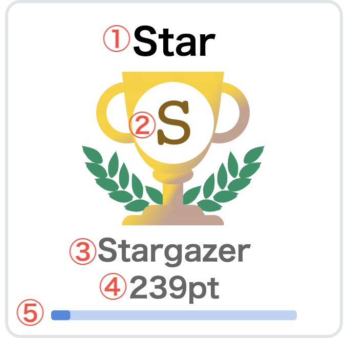
  </a>

  

      

        

 

 
<h2 align="left">About Me</h2>
 

I am a front-end and Android application developer passionate about creating interactive web experiences and modern applications. I enjoy exploring new technologies, developing useful software solutions, and continuously improving my programming and information security skills.

  <a href="https://github.com/Alostoura-Official">
    
  </a>

  <a href="https://github.com/Alostoura-Official">
    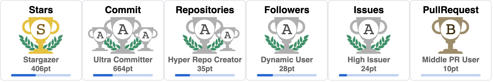
  </a>

  <a href="https://github.com/Alostoura-Official">
    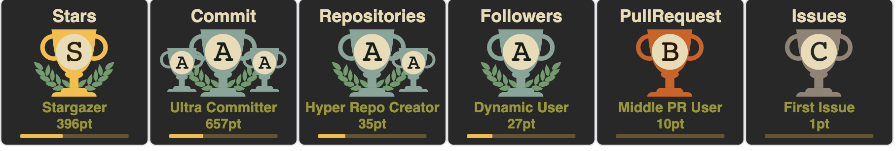
  </a>

  <a href="https://github.com/Alostoura-Official">
    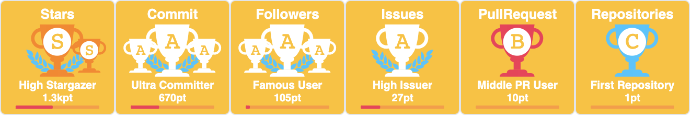
  </a>

  <a href="https://github.com/Alostoura-Official">
    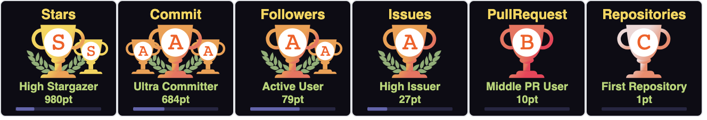
  </a>

  

  <a href="https://github.com/Alostoura-Official">
    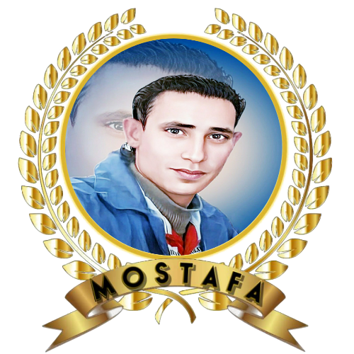
  </a>

  

<h2>ANDROID APPLICATION</h2>

📊 GitHub Statistics

&nbsp;

 

💻 𝐒𝐤𝐢𝐥𝐥 𝐒𝐞𝐭

<table>
  <tr>
    <td>
      
    </td>
    <td>
      
    </td>
    <td>
      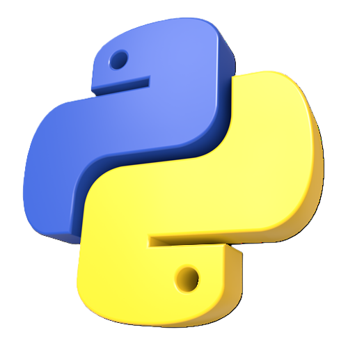
    </td>
    <td>
      
    </td>
    <td>
      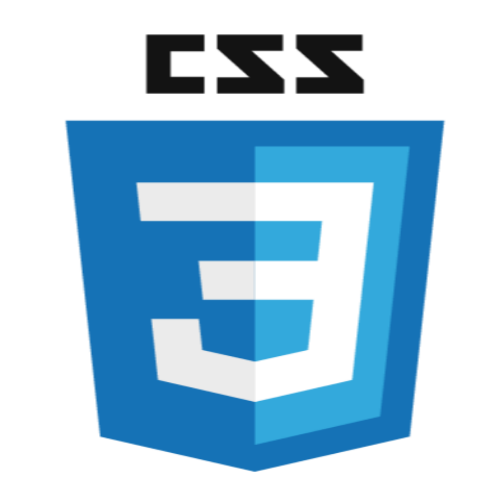
    </td>
    <td>
      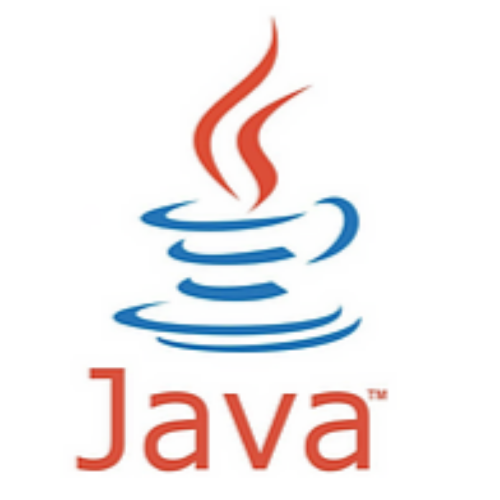
    </td>
    <td>
      
    </td>
  </tr>
</table>

 
<h3 align="center" > 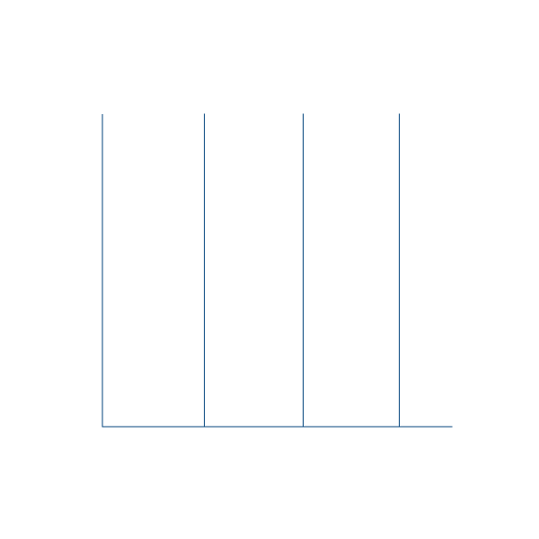Connect with me 🤝 </h3>

 

        
        
        
		
		
		
      

📝 ⚖️ الرخصة

تم نشر هذا الملف بموجب رخصة "MPL-2.0" (LICENSE).
